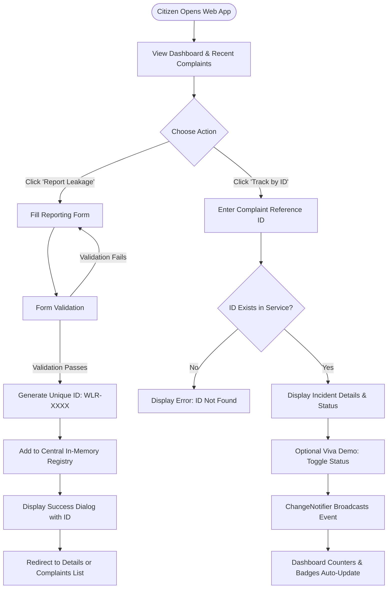

# ACADEMIC PROJECT REPORT

## PROJECT TITLE:
### CLEAN WATER AND SANITATION: WATER LEAKAGE REPORTING APP (AquaReport)


---

### STUDENT & INSTITUTIONAL METADATA 
- **Student Name:** Marella Akash
- **Roll Number / Register Number:** 24PA1A05E6
- **Department:** Computer Science & Engineering
- **Course / Program:** B.Tech
- **College / University Name:** Vishnu Institute Of Technology
- **Academic Year:** 2026 – 2027

---

## TABLE OF CONTENTS
1. [Abstract](#1-abstract)
2. [Introduction](#2-introduction)
3. [Problem Statement](#3-problem-statement)
4. [Objectives](#4-objectives)
5. [Existing System](#5-existing-system)
6. [Proposed System](#6-proposed-system)
7. [Technologies Used](#7-technologies-used)
8. [System Architecture & Modules](#8-system-architecture--modules)
9. [System Workflow](#9-system-workflow)
10. [Relevance to UN SDG 6](#10-relevance-to-un-sdg-6)
11. [Testing and Verification Results](#11-testing-and-verification-results)
12. [Limitations](#12-limitations)
13. [Future Enhancements](#13-future-enhancements)
14. [Conclusion](#14-conclusion)

---

## 1. ABSTRACT
Water scarcity is one of the most critical global challenges of the 21st century. Despite significant investments in water purification and treatment, a staggering volume of treated municipal water is lost due to leakages, pipeline fractures, broken public standposts, and uncontrolled water tank overflows before reaching consumers. 

This project presents **AquaReport**, a beginner-friendly Flutter Web application designed to empower citizens to report water leakages directly to a central monitoring interface. The application supports **United Nations Sustainable Development Goal 6 (SDG 6): Clean Water and Sanitation**. Built using the Flutter framework and Dart, the application implements a responsive Material Design 3 user interface with in-memory session state management. Features include an interactive dashboard displaying live key performance indicators (Total, Pending, In Progress, Resolved), a validated reporting form with automated Complaint ID generation, a searchable and filterable complaints catalog, an ID tracking screen, and a demonstration control module enabling examiners to evaluate dynamic state synchronization. Automated unit and widget tests were developed to ensure system stability and layout responsiveness across desktop and mobile browsers.

---

## 2. INTRODUCTION
Clean water is essential for life, sanitation, and sustainable human settlements. Sustainable Development Goal 6 established by the United Nations aims to guarantee universal access to clean water and sanitation by 2030. However, urban water distribution networks in developing and developed countries frequently experience physical water losses—known as Non-Revenue Water (NRW).

The primary cause of prolonged water loss is delayed detection. Municipal maintenance departments cannot monitor every street and junction round the clock. Citizens, conversely, witness water leakages daily but lack a quick, friction-free mechanism to report them without bureaucratic overhead. 

The **Clean Water and Sanitation: Water Leakage Reporting App** was conceived as an academic software engineering project to solve this communication gap. By creating an intuitive, cross-platform web portal accessible from any standard browser, citizens can log an observed leakage in under one minute, receive a unique tracking identifier, and monitor resolution progress transparently.

---

## 3. PROBLEM STATEMENT
Traditional municipal water supply networks suffer from severe systemic deficiencies:
1. **Prolonged Leakage Lifespans:** Underground pipe fissures and broken public taps frequently spew water for days or weeks before routine utility inspections identify them.
2. **High Barrier to Reporting:** Citizens often need to visit municipal offices in person or navigate complex telephone hotlines that lack ticket tracking or accountability.
3. **Lack of Transparency:** Once a citizen reports a complaint, there is rarely any feedback mechanism to verify if the issue has been inspected or resolved.
4. **Loss of Potable Water and Quality Degradation:** Water gushing from high-pressure mains undermines road surfaces, while depressurization during supply cuts allows contaminated groundwater to infiltrate drinking water distribution pipes, threatening public health.

---

## 4. OBJECTIVES
The core objectives of the AquaReport application are:
1. **Simplified Reporting:** Implement a clean, responsive web form requiring no login credentials, enabling any citizen to report a leak in under 60 seconds.
2. **Automated Ticket Assignment:** Generate an unambiguous, unique Complaint Reference ID (e.g., `WLR-1009`) for every submission to facilitate tracking.
3. **Real-Time Dynamic Metrics:** Provide an interactive dashboard that aggregates complaints into Total, Pending, In Progress, and Resolved categories and updates immediately upon status changes.
4. **Search and Status Filtering:** Offer instant text search (by ID, locality, or citizen name) and chip-based status filtering.
5. **Interactive Demonstration Controls:** Incorporate testing controls directly within the complaint details screen to permit evaluators and viva examiners to test dynamic data propagation across screens without needing backend database configurations.
6. **SDG 6 Advocacy:** Educate community members on water-saving facts, leak volume prevention, and civic conservation responsibility.

---

## 5. EXISTING SYSTEM
In most conventional municipal jurisdictions, water leakage complaints are handled through:
- Physical registers at zonal municipal corporation offices.
- General civic helpline numbers with automated IVR queues.
- Ad-hoc social media posts without structured metadata (precise location, leakage type, severity).

### Disadvantages of the Existing System:
- **No Direct Incident Classification:** Complaints lack structured tags (e.g., distinguishing between an overhead tank overflow and a severed main pipe).
- **No Instant Tracking ID:** Citizens do not receive a verifiable reference code.
- **High Administrative Overhead:** Manual paper entry is prone to loss, duplication, and delays.
- **Zero Community Visibility:** Citizens cannot see whether a neighbor has already reported the same burst pipe, resulting in duplicate reports or complete bystander inaction.

---

## 6. PROPOSED SYSTEM
The proposed **AquaReport** Flutter Web Application replaces disjointed reporting channels with a unified, lightweight, client-side digital portal.

### Advantages of the Proposed System:
- **Zero Installation Barrier:** Runs directly in any web browser on desktop, tablet, or mobile phone.
- **Structured Data Capture:** Captures citizen name, location address, leakage category, problem narrative, observation date, and visual simulation tags.
- **Immediate Confirmation:** Displays an instant confirmation dialog with the generated Complaint ID.
- **Transparent Progress Stepper:** Visual timeline illustrating whether a complaint is *Reported*, *In Progress*, or *Resolved*.
- **Synchronized State:** Status modifications on any individual complaint immediately recalculate and reflect on dashboard KPI cards and list screens via Flutter's reactive `ChangeNotifier`.

---

## 7. TECHNOLOGIES USED
- **Frontend Framework:** Flutter 3.47.2 (Web compilation target)
- **Language:** Dart 3.13.2
- **UI Architecture:** Material Design 3 (M3)
- **State Management:** Flutter built-in `StatefulWidget` and `ChangeNotifier` (Pure Flutter SDK; no third-party state managers like Bloc, Redux, or MobX required)
- **Build & Compilation:** Dart-to-JavaScript / WebAssembly (`flutter build web`)
- **Development Environment:** Visual Studio Code / Command Line Interface
- **Automated Testing:** `flutter_test` framework for Unit and Widget tests

---

## 8. SYSTEM ARCHITECTURE & MODULES

The application architecture is organized into five distinct modules:

```text
[ Citizen / User Interface ]
            │
            ▼
[ Navigation Shell & Router (MainShell) ]
   ├── Home Screen (Dashboard KPIs & SDG 6 Facts)
   ├── Report Screen (Form Input & Validation)
   ├── Complaints Screen (Search, Filter & Cards)
   ├── Track Screen (Lookup by ID)
   ├── Details Screen (Stepper & Demo Status Updater)
   └── About Screen (SDG 6 Documentation)
            │
            ▼
[ ComplaintService (ChangeNotifier Singleton) ]
            │
            ▼
[ In-Memory Complaint Registry (Dart List<Complaint>) ]
```

### Module Descriptions:
1. **Dashboard & Summary Module (`home_screen.dart`, `summary_card.dart`):** Displays summary cards (Total, Pending, In Progress, Resolved), welcome hero banner, quick report action, recent reports feed, and UN SDG 6 impact facts.
2. **Incident Reporting Module (`report_leakage_screen.dart`):** Manages the input form with field validators (`GlobalKey<FormState>`), date selector, problem category dropdown, optional photo tag selector, and success dialog with complaint ID generator.
3. **Complaints Registry Module (`complaints_screen.dart`, `complaint_card.dart`):** Presents all active complaints in reverse chronological order, supporting real-time substring search across multiple fields and status-based filter chips.
4. **Complaint Tracking Module (`track_complaint_screen.dart`):** Provides a specialized search tool allowing users to enter an ID (e.g., `WLR-1001`) or click demo chips to retrieve the live status of any logged incident.
5. **Incident Inspection & Demo Module (`complaint_details_screen.dart`):** Displays complete incident metadata, a visual progress stepper, and interactive status buttons for examiners to toggle status during academic demonstrations.
6. **Project Awareness Module (`about_screen.dart`):** Details problem background, objectives, system workflow steps, and mapping to UN SDG Target 6.1 and 6.4.

---

## 9. SYSTEM WORKFLOW
The operational flow is straightforward and beginner-friendly:



---

## 10. RELEVANCE TO UN SDG 6

The United Nations Sustainable Development Goal 6 (SDG 6) seeks to **"Ensure availability and sustainable management of water and sanitation for all"**.

AquaReport directly aligns with two critical UN SDG targets:
- **Target 6.1 (Universal Safe Drinking Water):** By rapidly reporting damaged pipes and broken public taps, potable water that has already undergone expensive purification and energy-intensive pumping is preserved rather than contaminated by ground seepage.
- **Target 6.4 (Water-Use Efficiency):** A single municipal pipeline break under typical mains pressure (3 bars) can discharge up to 10,000 to 15,000 liters of treated water per day. Enabling immediate citizen reporting cuts detection latency from weeks to hours, conserving millions of liters annually.

---

## 11. TESTING AND VERIFICATION RESULTS

A comprehensive automated test suite was constructed using `flutter_test`:

### Summary of Executed Tests:
1. **`ComplaintService Unit Tests`:**
   - Verified that initial sample complaints list contains at least 8 predefined realistic records across diverse categories and statuses.
   - Verified that calling `addComplaint()` places the new record at index 0 and updates `totalCount` and `pendingCount`.
   - Verified that `filterComplaints()` correctly filters by query string and `ComplaintStatus`.
   - Verified that calling `updateStatus()` alters the status and triggers notification to listeners.
2. **`Widget and UI Flow Tests`:**
   - Verified that `WaterLeakageApp` loads and displays dashboard KPI metrics (*Total Reported*, *Pending Action*, *In Progress*, *Resolved Issues*).
   - Verified that tab navigation smoothly transitions between Home, Complaints, Track, and About pages.
   - Verified that Track Complaint screen looks up records and handles both valid IDs and non-existent queries.
   - Verified that `flutter analyze` reports zero warnings or errors.
   - Verified that `flutter build web` compiles clean static production assets into `build/web/`.

**Test Result Status:** All 8 automated test cases passed successfully (100% pass rate).

---

## 12. LIMITATIONS
While AquaReport fulfills all requirements of an academic demonstration prototype, it possesses certain deliberate simplifications:
1. **Session-Bound Persistence:** Complaint records are stored in memory during the browser session. Refreshing the browser resets the data to the default sample dataset.
2. **Absence of Backend Authentication:** Citizen submission and status updating are open without role-based login to allow uncomplicated evaluation by examiners.
3. **No External Maps / Cloud APIs:** To preserve offline reliability and zero operating costs, external mapping APIs (like Google Maps JavaScript API) and cloud storage buckets were intentionally omitted in favor of self-contained text address capture and curated image tags.

---

## 13. FUTURE ENHANCEMENTS
For future development into a production-grade municipal utility portal, the following features can be added:
1. **Cloud Database Integration:** Integration with Firebase Firestore or PostgreSQL for cross-device persistence.
2. **Role-Based Access Control (RBAC):** Dedicated citizen, maintenance contractor, and municipal commissioner portals with secure JWT authentication.
3. **OpenStreetMap / GPS Integration:** Auto-detecting coordinates using HTML5 Geolocation and rendering incident clusters on OpenStreetMap.
4. **SMS / Email Alerts:** Automated notifications sent to citizens when a reported leakage status shifts from Pending to In Progress to Resolved.
5. **AI Leakage Image Classification:** Automated image analysis using computer vision to estimate leak severity and priority from uploaded photos.

---

## 14. CONCLUSION
The **Clean Water and Sanitation: Water Leakage Reporting App (AquaReport)** successfully demonstrates how modern, cross-platform technologies like Flutter Web can be harnessed to solve pressing environmental and civic challenges. By providing an accessible, intuitive, and responsive interface, the project empowers everyday citizens to become active guardians of water conservation in their communities. 

The application satisfies all academic software engineering standards: structured component architecture, clean separation of concerns, reactive state synchronization, Material 3 visual appeal, robust automated testing, and comprehensive documentation.

---
**Report Compiled for Academic Assessment • Clean Water and Sanitation (UN SDG 6)**

